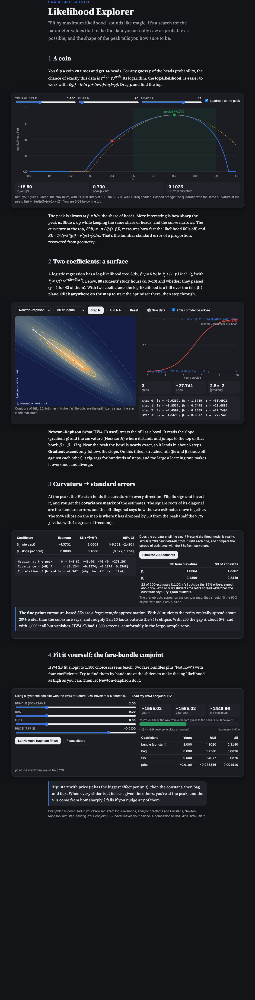

# Likelihood Explorer

An interactive article on how HW4 2B's logit fit actually works: **maximum likelihood, made visible.**



## Sections

1. **A coin.** Drag a guess *p* and watch ℓ(p) = h·ln p + (n−h)·ln(1−p). The peak sits at p̂ = h/n. A dashed quadratic with the same curvature at the top shows where SE = 1/√(−ℓ″(p̂)) = √(p̂(1−p̂)/n) comes from. Sliders for n and h show the peak sharpening as data grows.
2. **Logistic regression with two coefficients.** A contour map of ℓ(β₀, β₁) is drawn on a canvas with marching-squares contours.
   - **Click anywhere** to start the optimizer there, then step or run.
   - **Newton–Raphson** (β ← β − H⁻¹g, with step-halving) reaches the peak in about 6 steps.
   - **Gradient ascent** (with an adjustable learning rate) zig-zags along the tilted hill for about 1,700 steps, or diverges.
   - **Live view:** a side plot shows the current fitted curve against the data, with a step log.
3. **Curvature → standard errors.**
   - **The math:** the Hessian at the peak, the covariance (−H)⁻¹, SEs, CIs and the β₀/β₁ correlation, plus a 95% confidence ellipse (where ℓ has dropped by 3.0).
   - **"Simulate 200 datasets"** refits the model on data drawn from the fitted model. The estimates are plotted on the map and their spread is compared with the curvature SEs.
   - **The fine print:** with 80 students the refits spread about 20% wider than the curvature says. With 1,000 they agree. Curvature SEs are a large-sample approximation.
4. **Fit it yourself.** The fare-bundle conjoint has four sliders (bundle constant, bag, flex, price). Try to reach the maximum log-likelihood by hand, with a progress bar from a random guess to the peak. Then press "Let Newton–Raphson finish" to animate the iterations and reveal the MLE and SEs.
   - **Default data:** a synthetic dataset with the HW4 structure (1,500 screens).
   - **Your own file:** **"Load my HW4 conjoint CSV"** fits your actual file in the browser. It isn't included in this repo.

## Tests

```
node test.mjs
```

There are 13 checks:
- **Coin:** the peak is at h/n, and 1/√(−curvature) = √(p(1−p)/n).
- **Logistic derivatives:** the analytic gradient and Hessian match finite differences.
- **Optimizers:** Newton converges in 6 steps; gradient ascent needs 1,706 (more than 50×) and reaches the same maximum.
- **Standard errors:**
  - with 1,000 students, the curvature SEs match the SD of 1,000 refits within 5%, and 6.2% of refits fall outside the 95% ellipse
  - with 80 students, the refits are 21% wider, the documented small-sample effect, with no runaway fits
- **Marching squares:** recovers a circle of the right radius.
- **Conjoint:** the synthetic fit converges and lands within sampling error. **On the real HW4 file (if present locally), the MLE, SEs and LL match my HW4 2B answers exactly:** 4.3804, 0.8019, 0.4738, −0.028514; LL −1420.58.
